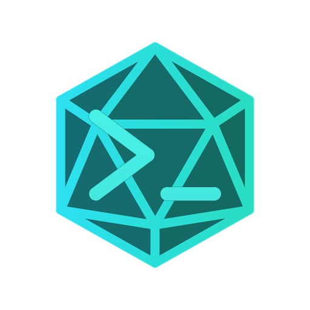

# Developer's Theme + iPhonePlay's Crystal Files

**Original project:** [Developer's Theme by Rajeshwaran](https://github.com/Rajeshwaran2001/developer-theme-dark)

This fork preserves Developer's Theme and extends its file icon theme with custom icons for **iPhonePlay's Crystal programming language**.

## 💎 iPhonePlay's Crystal Language Icons

Three custom icons have been added to the original file icon theme.

| Icon | File association | Description |
|---|---|---|
|  | `.crst` | Source files for iPhonePlay's Crystal language |
|  | `.crstproj` | Project files for iPhonePlay's Crystal language |
|  | `MakeCrystal` | The MakeCrystal utility |

### Icon files

**`icons/crystal.png`** — Used for `.crst` source files.

**`icons/crystalize.png`** — Used for `.crstproj` project files.

**`icons/makecrystal.png`** — Used for files named exactly `MakeCrystal`.

> **Important:** Crystal in this repository refers to iPhonePlay's own programming language. It does not refer to the unrelated Crystal programming language project.

## Installation

### Install the packaged extension

1. Download or clone this repository.
2. Open a terminal in the repository directory.
3. Install Microsoft's VS Code extension packaging tool if it is not already installed:

   ```powershell
   npm install --global @vscode/vsce
   ```

4. Package the extension:

   ```powershell
   vsce package --allow-missing-repository
   ```

5. Install the generated VSIX file in VS Code. The expected filename for version `6.0.0` is:

   ```powershell
   code --install-extension .\developer-theme-crystal-files-6.0.0.vsix
   ```

6. Open the Command Palette with `Ctrl+Shift+P`.
7. Select **Preferences: File Icon Theme**.
8. Choose **Rajeshwaran Developer's Theme + iPhonePlay's Crystal Files**.

The theme combines the original Developer's file icons with the three additional Crystal mappings.

## Original project

### Developer's theme

VS Code theme for developers.

> A dark theme for [Visual Studio Code](https://code.visualstudio.com/).
>
> For GitHub Actions, refer to [publish-vscode-extension](https://github.com/HaaLeo/publish-vscode-extension).

<p align="center">
  <a href="https://marketplace.visualstudio.com/items?itemName=Rajeshwaran.developer-theme-dark"></a>&nbsp;
  <a href="https://marketplace.visualstudio.com/items?itemName=Rajeshwaran.developer-theme-dark"></a>&nbsp;
  <a href="https://marketplace.visualstudio.com/items?itemName=Rajeshwaran.developer-theme-dark"></a>&nbsp;
  <a href="https://marketplace.visualstudio.com/items?itemName=Rajeshwaran.developer-theme-dark"></a>&nbsp;
  <a href="https://github.com/Rajeshwaran2001/developer-theme-dark/issues"></a>&nbsp;
  <a href="https://github.com/Rajeshwaran2001/developer-theme-dark/blob/main/LICENSE"></a>&nbsp;
  <a href="https://vscode.dev/theme/Rajeshwaran.developer-theme-dark"></a>&nbsp;
  <a href="https://discord.gg/N9WdqHdmC"></a>
</p>

## Preview of themes and colors

> Not too bright and not too subtle.

### Developer's Theme


### Firefox Dark


### Ocean Dark


### Slack Dark


### Green Coffee


### Aubergine Dark


### Product icons


### File icons


### Folder icons


## Development

The original project specifies **Node.js 22 or newer** in `.nvmrc`; npm 10 or newer is included with Node.js 22.

Install dependencies and run the original project's development scripts when needed:

```bash
npm ci
npm run build
npm test
```

Useful individual scripts from the original project:

| Script | Description |
|---|---|
| `npm run lint` / `npm run lint:fix` | Run ESLint or automatically fix supported issues |
| `npm run typecheck` | Run TypeScript checks without emitting files |
| `npm run format` / `npm run format:check` | Format or check formatting with Prettier |
| `npm run svgo-p` | Optimize product icons in `Pro-icons/` |
| `npm run svgo-mf` | Optimize file and folder icons in `icons/` |
| `npm run fonts` | Rebuild the icon font using Fantasticon |
| `npm run preview` | Regenerate file and folder icon preview images |
| `npm run package` | Build a VSIX package |

The icon font's codepoints live in `src/scripts/template/mapping.json` and must stay synchronized with the `fontCharacter` values in `product_icons/developer's-icons.json`. Changing a codepoint can change glyphs for existing theme users.

> **Running `npm test` from the VS Code integrated terminal?** VS Code exports `ELECTRON_RUN_AS_NODE=1`, which can prevent the downloaded test instance from launching with its required flags. On compatible Unix environments, try `env -u ELECTRON_RUN_AS_NODE npm test`.

The three Crystal icon additions are PNG assets referenced by `file_icons/developer-icons.json`.

## Icon sources

The original project credits the following icon sources:

- [Fluent Design Icons](https://fluenticons.co/)
- [Material Design Icons](https://materialdesignicons.com/)
- Official icons

The Crystal icons in this fork were created for iPhonePlay's Crystal language.

## Contributors

Original project contributors:

<a href="https://github.com/Rajeshwaran2001/developer-theme-dark/graphs/contributors">
  
</a>

## Credits

- **Original Developer's Theme:** [Rajeshwaran](https://github.com/Rajeshwaran2001/developer-theme-dark).
- **Crystal icons and integration:** iPhonePlay.
- **Original project license:** GPL-3.0.

This repository is a modified version of Developer's Theme. The original project's license and applicable copyright notices must be retained when redistributing the fork. See the included `LICENSE` file for the complete terms.
